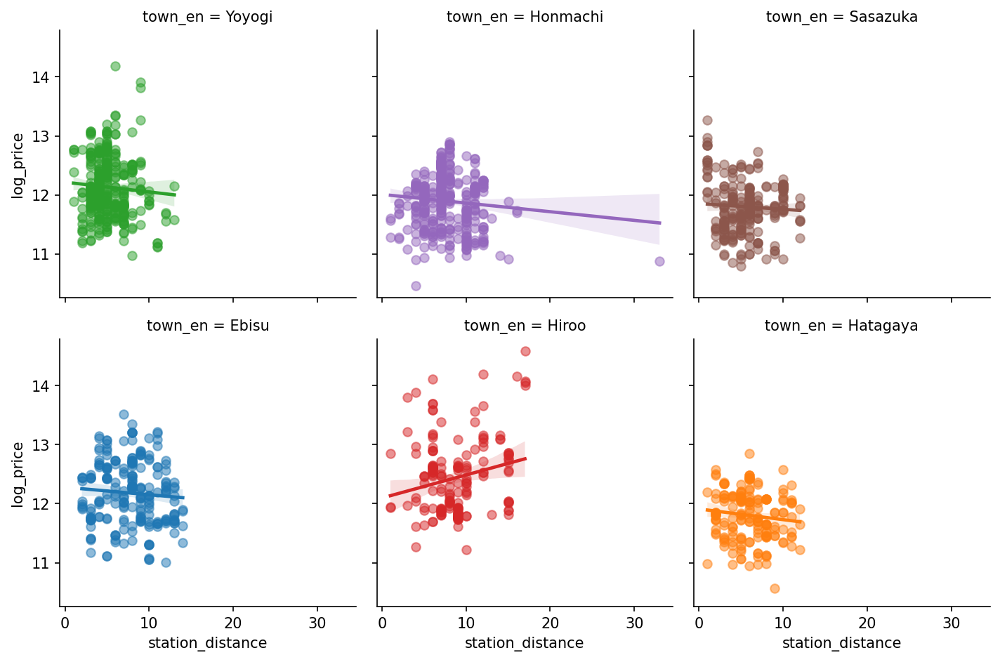
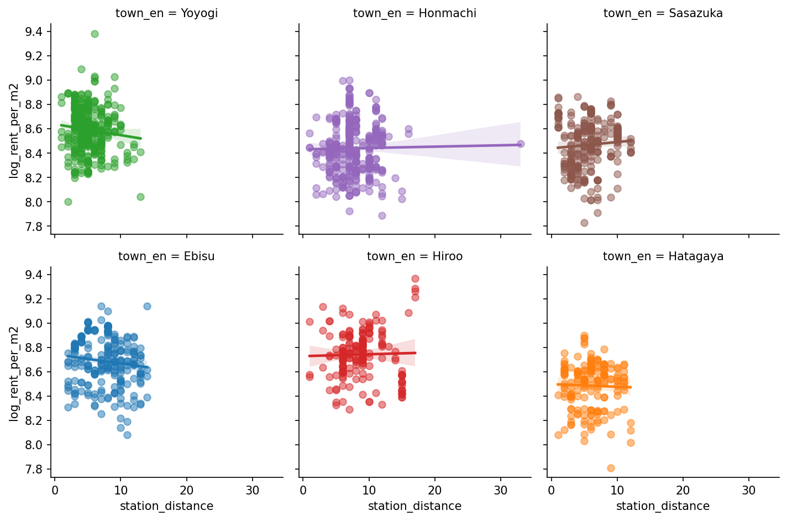
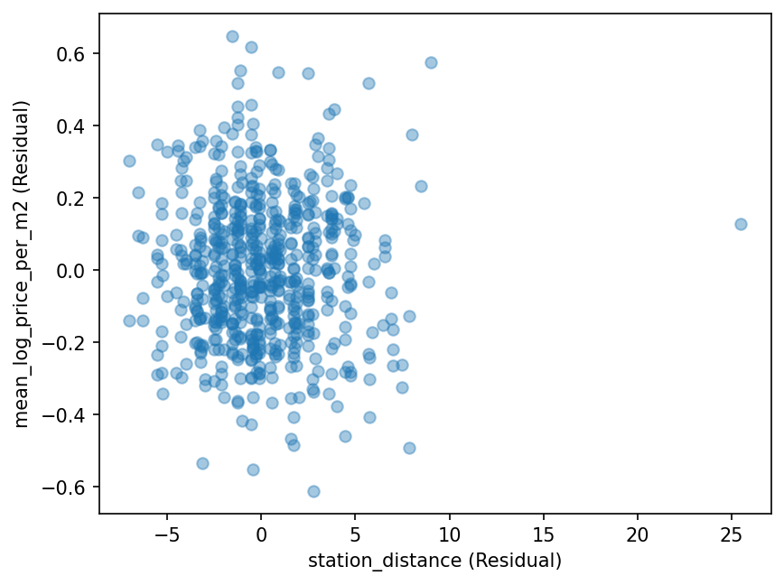
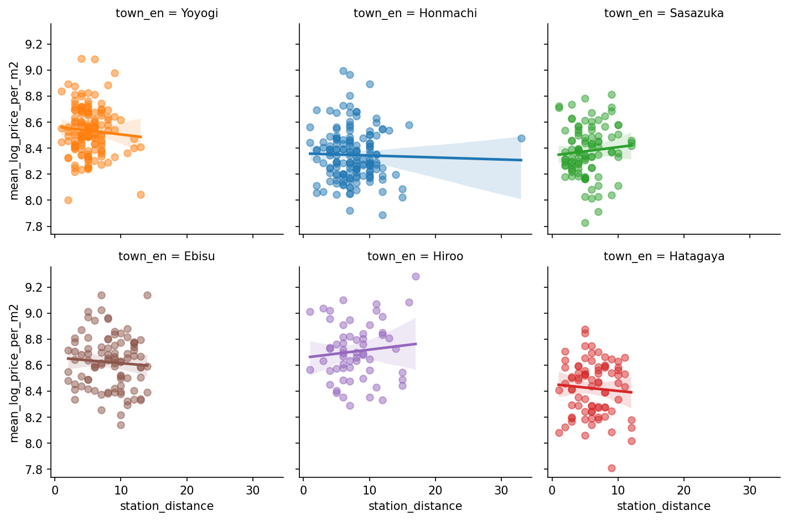

# Phase 3 まとめ：EDAによる駅徒歩効果の解明

Phase 2（`docs/phase2_summary.md` 2節注記・10節・11節）では、①駅徒歩分数の分散不足、②station_distanceによるエリア質（`area_group`）の代理、③駅徒歩効果の異質性（heterogeneous treatment effect）という3つの仮説を立てたまま、③の検証は未着手で残っていた。①の因果推定（共変量調整OLS・CEM）は非有意という結論で、後日発見した`area_group`抽出の正規表現バグ（同10節）の修正後もこの結論は変わっていない（同2節注記）。なお予測モジュール（適正価格モデル）の係数はバグ修正後にクラスター補正でp<0.05になったが、これは予測タスク用の係数であり①の因果効果の証拠としては扱っていない（同2節「参考」段落）。本Phase 3で検証した③（上位6町での異質性）自体は、このバグの影響を受けた「渋谷区東」が対象6町に含まれていないため、以下の結論に変わりはない。Phase 3では、複雑な手法に進む前にまず素朴な可視化（EDA）でこの③を検証した。

---

## 目次

1. [Phase 3 概要・目的](#1-phase-3-概要目的)
2. [仮説検証結果（EDAグラフの分析結果と事実）](#2-仮説検証結果eda-グラフの分析結果と事実)
3. [結論：渋谷区における家賃形成メカニズム](#3-結論渋谷区における家賃形成メカニズム)
4. [エンジニアリング上の教訓](#4-エンジニアリング上の教訓)
5. [Phase 4（GIS空間特徴量アプローチ）への展開](#5-phase-4gis空間特徴量アプローチへの展開)

---

## 1. Phase 3 概要・目的

Phase 2までに、①駅徒歩分数の分散不足・②station_distanceによるエリア質（`area_group`）の代理という2つの仮説を、因果推定用の2手法（共変量調整OLS・CEM）で検証し、「駅徒歩効果は非有意」という結論に到達していた（後日発見した`area_group`の正規表現バグを修正した後も、この2手法での結論は変わっていない。`docs/phase2_summary.md` 2節注記・10節参照。以下の③の検証結果自体には影響しない）。ただし③駅徒歩効果の異質性（渋谷区内でも繁華街と高級住宅地では効果の符号自体が異なり、平均すると相殺されている可能性）は仮説として提示したのみで検証していなかった（同10節）。

Phase 3の目的は、CEMの拡張やGIS導入といった重い手法に進む前に、まず町名別に駅徒歩と価格の関係を素朴に可視化し、③の当否を確認すること。

---

## 2. 仮説検証結果（EDAグラフの分析結果と事実）

### 2.1 可視化（`practice/practice.ipynb`）

price有りroom 2,998件のうち`app.analysis.matching.load_analysis_data`が算出する本番の`area_group`から町名を抽出し、件数上位6町（Yoyogi代々木364件・Honmachi本町358件・Sasazuka笹塚251件・Ebisu恵比寿231件・Hiroo広尾182件・Hatagaya幡ヶ谷176件）を対象に、`seaborn.lmplot`で町別にfacetした散布図＋回帰直線（信頼区間付き）を作成した。

> **補足**: 当初は`practice/practice.ipynb`内で独自に実装した簡易正規表現（`渋谷区([^\d０-９丁目番]+)`）を使っていたが、本番の`area_group`定義と処理が2箇所に分かれること自体がバグの温床になるため、`load_analysis_data`を直接importする形に統一した（2.5節）。両者の抽出結果は上位6町の顔ぶれ・件数について完全に一致することを確認済み。

**グラフ1: Log(Price) vs station_distance（町名別）** — Hiroo（広尾）のみ、駅から離れるほど価格が上がる明確な右肩上がりの傾向が見られた。他5町は概ね横ばい〜やや右肩下がりだった。この時点では、町によって駅徒歩の効き方の符号が異なる（③効果の異質性）ように見えた。

**グラフ2: Log(Rent/m2) vs station_distance（町名別）** — 目的変数を専有面積で正規化した平米単価（`price / liv_area`）に変更したところ、Hirooの右肩上がりは大幅に縮小した。同時に、他5町を含む上位6町すべての回帰直線がおおむね水平に近づいた。

この可視化だけでは「他の共変量（age・floor・building_structure・brand_score）を統制していない」「回帰直線の係数・p値を算出していない」という限定が残るため、`scripts/check_station_town_heterogeneity.py`でbuilding単位クラスターロバストSEを使った数値検証を追加で行った。

### 2.2 分散分解（between町間 / within町内）

町別の交互作用検定に進む前に、station_distanceの分散がそもそも町内にどれだけ残っているかを確認した。

| 対象 | n | 群数 | 全体SD | between比率 | within比率 | within SD |
|---|---|---|---|---|---|---|
| 上位6町（このEDAと同じ対象） | 1,562 | 6 | 3.113分 | 16.6% | 83.4% | 2.847分 |
| 全area_group（本番モデルと同じ対象） | 2,998 | 31 | 3.018分 | 21.9% | 78.1% | 2.681分 |

`area_group`固定効果が説明しているのはstation_distanceの分散のうち2割程度に過ぎず、8割前後は町内に残っている。これは`docs/phase2_summary.md` 11節の「station_distanceの分散自体が`area_group`にほぼ吸収されている」という記述が不正確だったことを意味する（11節・10節は本ドキュメントの結果を踏まえて修正した）。町別の交互作用検定は、情報不足で無意味になるほどではなく、実施する価値があると判断した。

### 2.3 町内での station_distance と liv_area の相関

| 町 | corr(station_distance, liv_area) | n |
|---|---|---|
| 代々木 | +0.005 | 364 |
| 本町 | -0.065 | 358 |
| 笹塚 | -0.152 | 251 |
| 恵比寿 | +0.022 | 231 |
| **広尾** | **+0.258** | 182 |
| 幡ヶ谷 | -0.107 | 176 |

広尾だけ他町より明確に高い正の相関（+0.258）を示しており、「広尾の駅から遠い部屋は専有面積が大きい」という交絡仮説を数値的に裏付けている。

### 2.4 交互作用項の共同検定・町別スロープ

`station_distance × C(area_group)`（上位6町、building単位クラスターロバストSE）の交互作用項が共同でゼロと言えるかをWald検定で確認した。

| モデル | 共同検定 p値（df=5） |
|---|---|
| liv_area無し（生のlog_price） | 0.728 |
| liv_area追加後 | 0.823 |
| 目的変数を平米単価に変更（log_rent_per_m2） | 0.834 |

いずれも強く非有意（p>0.7）で、③（町ごとに効果の符号・大きさが異なる）は統計的に支持されなかった。重要なのは、**liv_areaを追加する前の生のlog_priceモデルの時点で既に非有意（p=0.728）**だったこと。つまりグラフ1で見えたHirooの右肩上がりは、liv_areaで補正して初めて消えたわけではなく、6町という限られたサンプル（Hirooはbuilding数59）の中では最初から統計的に意味のある異質性として検出できていなかった可能性が高い。

町別に個別回帰した場合も、全町で係数の符号はバラバラ（代々木-0.90%〜笹塚+0.52%/分）だが、いずれもp>0.2で個別に有意な町は一つもなかった（Hirooはp=0.905とほぼゼロ）。

### 2.5 area_group調整後の「平均的な」傾きの確認（部分回帰プロット）

building単位に集計したデータ（`station_distance`・`mean_log_price_per_m2`をbuilding_idごとに平均）に対して、それぞれ`C(area_group)`だけで回帰した残差同士をプロットする部分回帰プロット（added-variable plot）を作成した。

当初は2.1節と同じくノートブック独自の簡易正規表現でarea_groupを作っていたが、本番の実装と処理が2箇所に分かれること自体がバグの温床になるため、`practice/practice.ipynb`から`app.analysis.matching.load_analysis_data`を直接importする形に統一した（本節・2.6節のグラフ3・4を含め、以降すべて本番の`area_group`を使用）。作り直した結果、上位6町の顔ぶれ・件数・回帰直線の形はいずれも旧バージョンと完全に一致しており、この2つの正規表現は今回のデータに対しては実質的に同じ結果を返すことを確認できた。

町の効果（切片のみ）を取り除いた後も、原点付近を中心にほぼ対称な散らばりで、傾向は見られない。

> **注意**: この図が示せるのは「`area_group`で切片を調整した後の、全町に共通する平均的な傾き」がフラットだということだけであり、③（町ごとに傾きの符号・大きさが異なる）を直接否定する証拠にはならない。`C(area_group)`は各町の平均レベルしか調整しておらず、傾き自体は町ごとに違ったまま1本の直線に平均化されうるため、この図1枚だけでは「異なる符号の傾きが互いに打ち消し合ってフラットに見えている」可能性を排除できない。③を直接確認するには、町ごとに別々の傾きを見る必要がある（2.6節）。

### 2.6 町別の傾きの直接確認（③への直接の可視化）

2.4節の交互作用共同検定に対応する可視化として、building単位データを町ごとに色分け・facetし、町ごとに別々の回帰直線を引いた。

代々木・本町・幡ヶ谷はやや右肩下がり、笹塚・広尾はやや右肩上がり、恵比寿はほぼフラットと符号はバラバラだが、いずれの町も傾きの大きさ自体は緩やかで、突出して急な町はない。特に広尾は、room単位のグラフ1では他を圧倒する右肩上がりだったが、building単位（疑似反復解消後）では笹塚と同程度の緩やかな傾きに収まっている。2.4節の町別係数（代々木-0.90%、本町+0.11%、笹塚+0.52%、恵比寿-0.76%、広尾+0.15%、幡ヶ谷-0.21%、いずれもp>0.2）とも符号がほぼ一致しており（本町のみ符号が逆だが、係数自体がほぼゼロなので誤差の範囲）、数値検定と可視化がここで初めて同じ問い（③）に対して整合する形になった。

### 解釈

以上を総合すると、Hirooの「駅から遠いほど価格が高い」という見かけの効果は、駅徒歩の真の効果の符号が町によって異なる（③）ことの表れではなく、専有面積との交絡（2.3節）と、room単位の疑似反復・Hiroo単独（building数59）というサンプルの小ささによる視覚的な誇張が重なったものだった、と考えられる。交互作用の共同検定（2.4節）・町別の傾きの直接可視化（2.6節）はいずれも一貫して「検証した上位6町の間で、符号の異なる大きな効果を検出することはできなかった」ことを示している。ただし非有意は「異質性がないと証明された」ことを意味しない。検証対象は上位6町（全体の約半数）に限られ、それ以外の町については未検証であり、統計的検出力の限界（2.4節）も踏まえると、③は「支持する証拠が得られなかった」という水準の結論に留まる。

---

## 3. 結論：渋谷区における家賃形成メカニズム

平米単価ベースで見る限り、上位6町いずれにおいても町内の駅徒歩1〜10分程度の差は価格にほとんど寄与していない。①②③の3仮説は、今回のEDA・数値検証により次のように整理できる。

- **①検出力不足**: 一部訂正の上で維持。station_distanceの分散のうち8割前後は町内に残っており（2.2節）、当初想定していたほど「分散そのものが尽きている」わけではない。それでも町別の個別スロープはいずれも広い信頼区間（p>0.2、2.4節）に留まっており、町単位まで細分化した場合の検出力不足という意味では引き続き妥当。
- **②station_distanceによるエリア質の代理**: 支持される。町名間のベース水準の差（グラフ2で見ると町ごとにおよそ8.4〜8.8の範囲でシフトしている）が価格差の主要因であり、station_distanceはこの差を部分的に代理していたに過ぎない。ただし「station_distanceの分散自体がarea_groupに吸収されている」という従来の説明（`docs/phase2_summary.md` 旧11節）は不正確で、正しくは「分散は町内に十分残っているが、その範囲内でのstation_distanceと価格の相関がもともと小さい」という形で②を再定義する。
- **③効果の異質性**: 検証した上位6町の範囲では支持されなかった（非有意＝証明ではない）。交互作用項の共同Wald検定はliv_areaの有無・目的変数（log_price / log_rent_per_m2）によらず一貫して非有意（p=0.73〜0.83、2.4節）。見かけ上の異質性（Hirooの右肩上がり）は専有面積との交絡と、Hiroo単独のサンプルの小ささ（building数59）が重なって生じた視覚的な印象だった可能性が高い。ただし①と同様、「町ごとの真の効果は同一」と証明されたわけではなく、6町・df=5という検定の検出力でどの程度の異質性まで検出できたか自体は検証していない。

以上より、「駅徒歩そのものの限界効果は、少なくとも検証した上位6町（渋谷区の物件の半数程度）の範囲では、町によって符号が大きく異なるような効果は見当たらず、全体として小さい」という解釈が、可視化・分散分解・交互作用検定のいずれの角度から見ても一貫して支持される。①で述べた検出力の限界（真にゼロか検出力不足かは未決着）は、この町別の分析にもそのまま当てはまる。

**scope上の注意**: この結論は「station_distance・town・専有面積」という3変数の関係に限定したものであり、「家賃を決めているのはこの3点のみ」という主張ではない。Phase 2の因果推論モデル（`docs/phase2_summary.md` 11節）で既に確認済みの、floor（建物固定効果で+0.85%/階）・brand_score（+1.96%）・age（-0.77%/年）等の他の変数の重要性を否定するものではない。あくまで「駅徒歩という1変数に限っては、その効果はエリアの質の代理変数に過ぎず、実質的な限界効果はゼロに近い」という、既存の②の結論を可視化ベースで補強するものと位置づける。

---

## 4. エンジニアリング上の教訓

- **目的変数の正規化を先に疑う**: Hirooの「駅遠プレミアム」は、CEMや交互作用項のような複雑な手法を追加する前に、価格を専有面積で正規化するという基本的な前処理だけでほぼ解消した。手法の高度化より先に、目的変数・特徴量の定義そのものが適切かを疑うべきだった。
- **見かけの効果の異質性は交絡変数のサインであることがある**: ③の仮説（傾きの異質性）は、実際には「未統制の交絡変数（面積）＋小サンプルの視覚的なばらつき」が生んだ見かけの異質性だった。真の異質性と、単なる欠落変数バイアス・サンプルサイズ由来のばらつきの町別発現は、素朴なEDAだけでは区別できない。
- **可視化の結論は、必ず数値検定で裏付ける**: グラフだけを見ると「liv_areaで補正したから異質性が消えた」ように見えるが、実際に交互作用項を数値で検定すると、liv_area補正前の生のlog_priceモデルの時点で既に非有意（p=0.728）だった（2.4節）。つまり可視化上の「補正前は異質、補正後は均一」という物語は、統計的には成立していなかった。可視化は仮説を発見する道具として有効だが、「解決した／しなかった」の判定は必ず数値検定（クラスターロバストSE込み）で行うべきで、この順番を間違えると誤った物語を確信を持って語ってしまうリスクがある。
- **分散分解は交互作用検定の前に済ませておく価値がある**: `C(area_group)`を入れた後にstation_distanceの情報がどれだけ残っているか（2.2節のbetween/within分解）を先に確認したことで、「町別の検定をやる価値があるか」を手を動かす前に判断できた。これによって、既存ドキュメントの「分散がarea_groupにほぼ吸収されている」という誤った記述も見つかった。
- **「何を調整したか」で、その図が答えられる問いは変わる**: 2.5節の部分回帰プロットは、`C(area_group)`で各町の切片（平均レベル）だけを調整したもので、傾き自体は一切触っていない。そのため「area_group調整後の平均的な傾きがフラットか」は示せても、「町ごとに傾きの符号が違うか（③）」には答えられない図だった。1本の回帰直線に見えても、それが「共通の傾きを仮定した上での平均」なのか「町ごとに別々に推定した傾き」なのかで、証明できることが全く違う。可視化を検定の代わりに使う際は、その図の裏にある回帰式（何がXで、何が固定効果で、傾きは共通か町ごとかを式で書き下す）を必ず確認する必要がある。

---

## 5. Phase 4（GIS空間特徴量アプローチ）への展開

駅徒歩という単一の離散変数を町ごとに追いかけるアプローチの限界が、本Phaseの可視化で実証的に裏付けられた。この結論は、`docs/phase2_summary.md` 10節で既に述べた「エリア（自治体）拡張は根本対応にならない、町名の離散固定効果ではなく連続的な地理特徴量(GIS)に置き換えるべき」という方向性と整合的である。

次のフェーズでは、グラフ2で観測された町名間のベース水準の差（8.4〜8.8のレンジ）の"正体"を、町名という離散カテゴリのままにせず、緯度経度ベースの連続的な空間特徴量（最寄り駅・繁華街までの直線距離、POI密度、公示地価等、PostGIS導入）で分解することを目指す。町名固定効果を連続変数に置き換えることで、station_distanceの情報を無駄に潰さずに、より精緻な立地プレミアムの構造を掴めることが期待される（README「設計思想」参照）。
